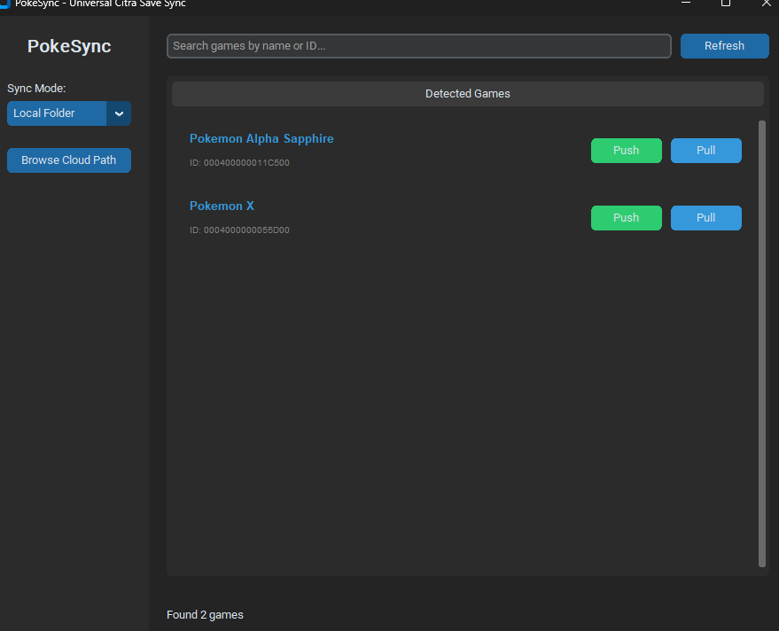

# PokeSync - Emulator Save Sync

PokeSync backs up and syncs your emulator saves between computers using a cloud folder (Dropbox/OneDrive/Google Drive) or GitHub. If a save ever disappears, it is still in your cloud copy and can be restored from the app.



## Features
- **Many emulators**: Nintendo 3DS, DS, GB/GBC/GBA, GameCube, Wii, PlayStation 1/2, PSP, and anything you run through RetroArch. See [Supported emulators](#supported-emulators).
- **Finds your games for you**: known emulator folders are scanned automatically, and you can add scan folders (for example your ROM folder) to find saves that live next to ROMs.
- **Metadata**: every push records the game name, emulator, platform, region, file sizes, checksums, timestamps and which computer it came from.
- **Restore lost saves**: saves that exist in the cloud but not on this computer are listed with a Restore button.
- **Save states (optional)**: turn on "Include save states" in the sidebar to sync those as well. Off by default.
- **Safe**: Automatically backs up your saves before they are overwritten.
- **Smart**: Warns you if you are about to overwrite a newer save.
- **Easy UI**: Simple buttons to "Push" (upload) or "Pull" (download) your progress.

## Supported emulators

| Emulator | Platform | Saves | Save states | Found via |
|---|---|---|---|---|
| Citra, Azahar, Lime3DS | Nintendo 3DS | save data folder of each title | `.cst` | emulator folder |
| mGBA / VisualBoyAdvance | GB, GBC, GBA | `.sav` next to the ROM | `.ss0`-`.ss9` | scan folders |
| melonDS | Nintendo DS | `.sav` next to the ROM | `.mln*` | scan folders |
| DeSmuME | Nintendo DS | `.dsv` | `.ds*` | scan folders |
| Dolphin | GameCube, Wii | memory cards, Wii save data | `StateSaves` | emulator folder |
| RetroArch | many | `saves` folder (`.srm`, `.sav`, ...) | `states` folder | emulator folder, scan folders for `.srm` |
| DuckStation | PlayStation | `memcards` | `savestates` | emulator folder |
| PCSX2 | PlayStation 2 | `memcards` | `sstates` | emulator folder |
| PPSSPP | PSP | `PSP/SAVEDATA` (game title read from `PARAM.SFO`) | `PSP/PPSSPP_STATE` | emulator folder |

Only the Citra folder layout has been checked against the emulator's documentation. The other default locations are best-known defaults that have not been tested against real installs yet. If an emulator keeps its data somewhere else, set the folder in `config.json`:

```json
{
    "emulator_paths": {"dolphin": "D:/Games/Dolphin", "retroarch": "/mnt/games/retroarch"},
    "scan_folders": ["D:/ROMs"],
    "enabled_emulators": null,
    "include_savestates": false
}
```

Emulator ids: `citra`, `azahar`, `lime3ds`, `mgba`, `melonds`, `desmume`, `dolphin`, `retroarch`, `duckstation`, `pcsx2`, `ppsspp`. Set `enabled_emulators` to a list of ids to only look for those.

Saves that live next to a ROM (mGBA, melonDS) are only recognised when the matching ROM file sits in the same folder.

## Adding another emulator
Emulators are small plugins in the `emulators/` folder. Write a subclass of `Emulator` that knows where the emulator keeps its data and returns `SaveEntry` objects, add a `build()` function, and register the module in `emulators/__init__.py`. Game-specific metadata (for example reading the in-game location out of a save file) can be added by appending a function to `EXTRACTORS` in `emulators/metadata.py`.

## Where saves are stored
Inside your cloud folder or GitHub repository:

```
<emulator>/<game id>/save/...files...
<emulator>/<game id>/save/.pokesync.json   (metadata)
<emulator>/<game id>/states/...            (only with save states enabled)
```

Saves pushed by older, Citra-only versions of PokeSync (`<title id>/main`) are still read and can be restored.

## Quick Start (3 Commands)

### Linux
```bash
git clone <your-repo-url> && cd pokesync
./setup.sh
python3 main.py
```

### Windows
See the detailed [USAGE_GUIDE.md](USAGE_GUIDE.md) for Windows installation and troubleshooting.

```powershell
git clone https://github.com/FaiGiJoon/PokeSync; cd pokesync
.\install.ps1
python main.py
```

### macOS
```bash
git clone <your-repo-url> && cd pokesync
./setup_macos.sh
python3 main.py
```

### Docker (Production Ready)
```bash
docker-compose up -d
```

## How to Sync

### Option A: Local Cloud (Easiest)
1. Set **Sync Mode** to "Local Folder".
2. Click **Browse Cloud Path** and select a folder in your Dropbox, OneDrive, or Google Drive.
3. Use **Push** to upload your save and **Pull** on your other computer.

### Option B: GitHub (Advanced)
See the [GUIDE.md](GUIDE.md) for step-by-step GitHub setup.

## Safety & Security
- **Backups**: Your existing saves are copied to `backups/` every time you pull.
- **Isolation**: When using Docker, the app runs in a containerized environment.
- **Secure Access**: We recommend using **Tailscale** for remote access (see below).

## Remote Access (Tailscale)
To sync your saves from anywhere without opening ports on your router:
1. **Install Tailscale** on both your local and remote machines.
2. **Enable Tailscale SSH** in your Tailscale dashboard.
3. Use the included `sync_data.py` script to fetch saves securely:
   ```bash
   python sync_data.py [user] [tailscale-ip] 22 [remote-path] [local-path]
   ```

## Advanced: Auto-Run on Boot (Linux)
1. Copy the service file: `cp pokesync.service ~/.config/systemd/user/`
2. Enable it: `systemctl --user enable --now pokesync.service`

## Running the tests
```bash
pip install -r requirements-dev.txt
pytest
```
